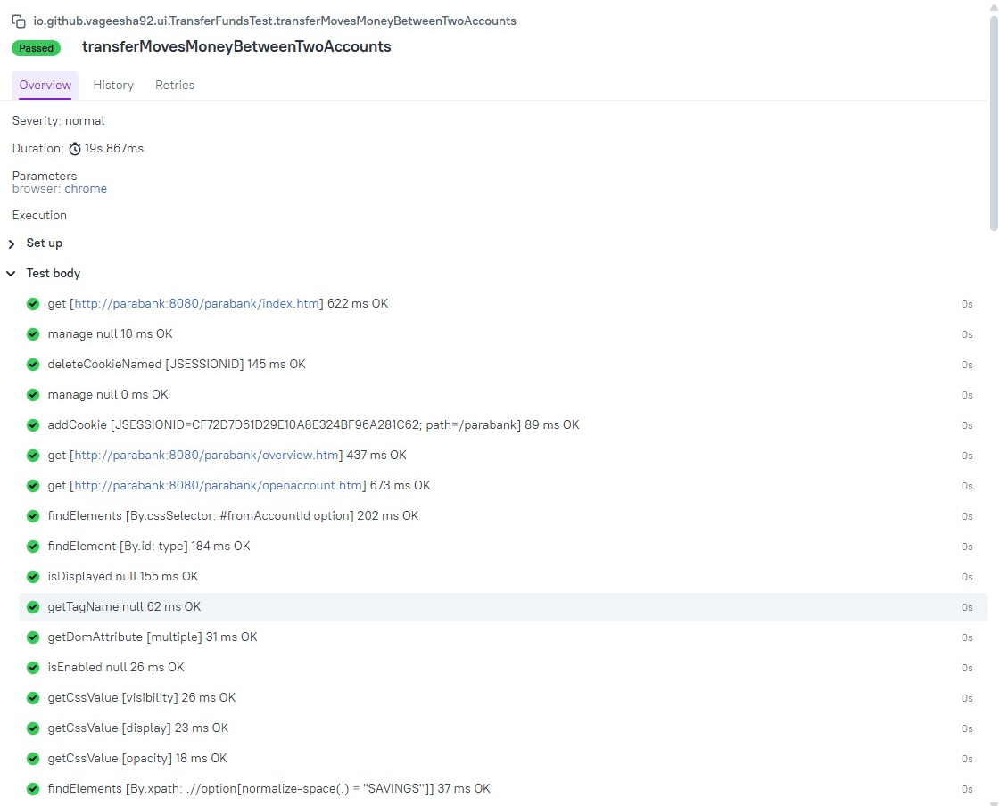

# parabank-automation

[](https://github.com/vageesha92/parabank-automation/actions/workflows/ci.yml)

A test framework I built for ParaBank (a demo bank), in Java 21.



## About

- I am a Senior QA Engineer / SDET with 8 years of experience in automation and manual testing, in agile teams.
- I built this repo to show how I test a banking application in Chrome, then Firefox, with parallel tests in
  each browser on CI using GitHub Actions.
- ParaBank has a web UI, an API and a database, so I wrote tests for all three.

## What I built

- UI tests with Selenium on a Grid, in Chrome and Firefox, running in parallel
- Page objects for the ParaBank pages
- API tests with Rest Assured, including a JSON schema check
- SQL checks against ParaBank's own database (JDBC)
- An Allure report that shows a screenshot, the last driver actions and the browser console when a UI test fails
- A GitHub Actions pipeline that runs both suites on every push to `main`

## Run it

You need:
- Docker with Compose v2 (about 6 GB of memory for Docker)
- JDK 21 (no Maven install needed: `./mvnw` downloads Maven 3.9.16, the version set in
  `.mvn/wrapper/maven-wrapper.properties`)
- free ports 8080, 8081, 4444, 19001, 7900 and 7901

```bash
docker compose up -d --wait   # ParaBank, the extras page, the Grid, Chrome and Firefox
./mvnw verify                 # API suite
./mvnw verify -Dsuite=ui      # UI suite: Chrome, then Firefox
```

## Layout

Code is in `src/test/java/io/github/vageesha92/`:
- `core/` - config, driver setup (`DriverFactory`, `DriverManager`), action log and failure listener
- `ui/pages/` - page objects
- `ui/` - UI tests
- `api/` - API tests and the Rest Assured client
- `db/` - JDBC helpers for ParaBank's database

Suites are `src/test/resources/testng-api.xml` and `testng-ui.xml`. CI is in `.github/workflows/ci.yml`.

## Known limits

- ParaBank's API needs no login, so I did not test authentication.
- The API tests reset the demo data (`POST /initializeDB`), and the UI tests use the same data, so I run the two
  suites one after the other, never at the same time.
- I run the UI tests only in Chrome and Firefox, not Edge or Safari.

## More

- [How the driver works](docs/driver-lifecycle.md)
- [Test strategy](docs/TEST_STRATEGY.md)
